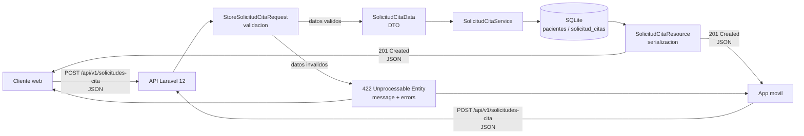

# Diagrama de intercambio

## Explicación

1. El cliente web o móvil envía un JSON al endpoint.
2. Laravel deserializa el cuerpo y el `FormRequest` valida campos, tipos y reglas de negocio.
3. Si hay errores, responde `422` con `message` y `errors`, sin persistir nada.
4. Si los datos son válidos, el DTO transporta la información al servicio.
5. El servicio registra la solicitud en SQLite con estado `pendiente`.
6. El recurso serializa el modelo y devuelve `201` con el contrato de respuesta.
