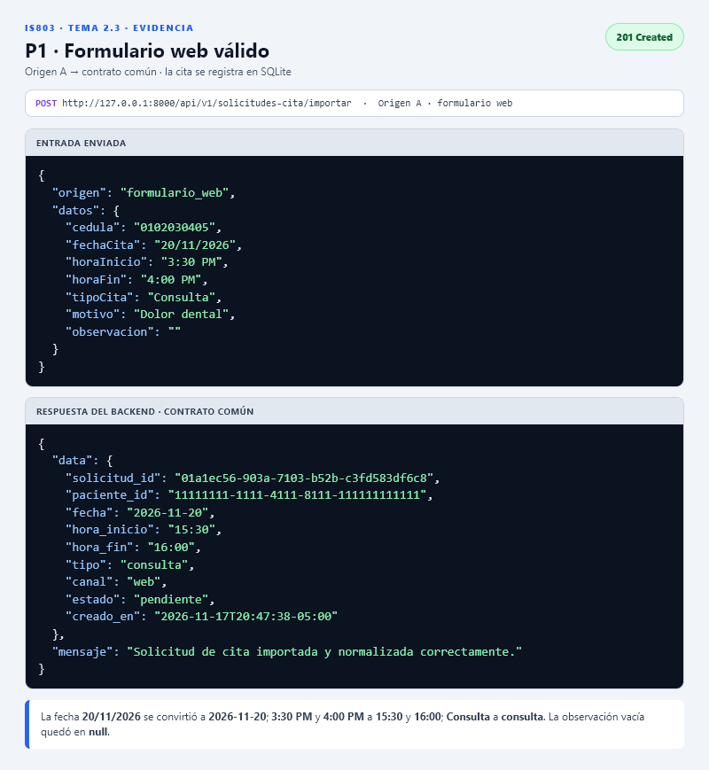
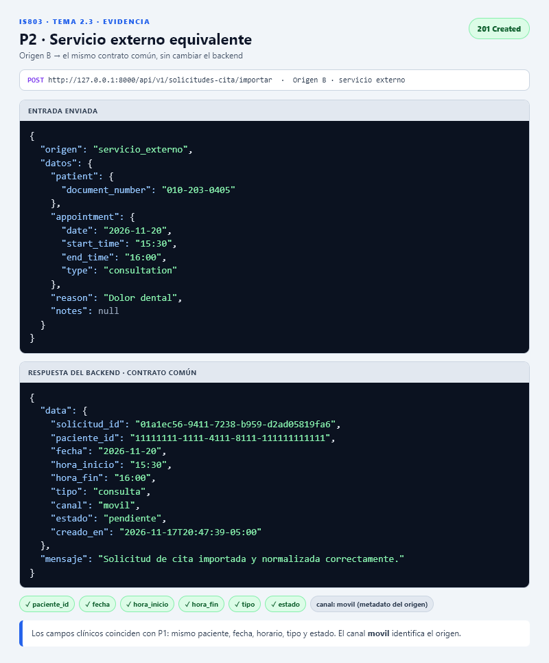
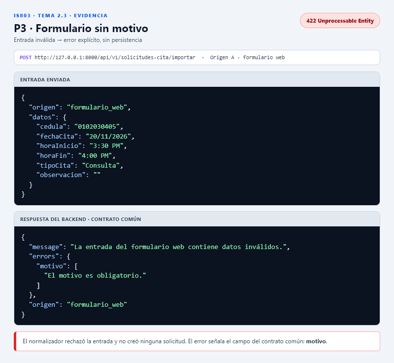
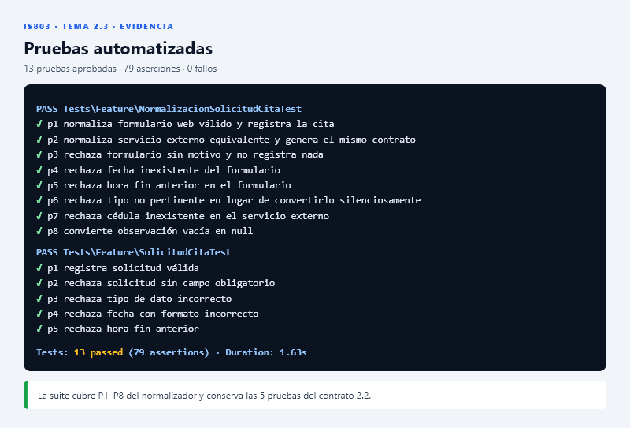
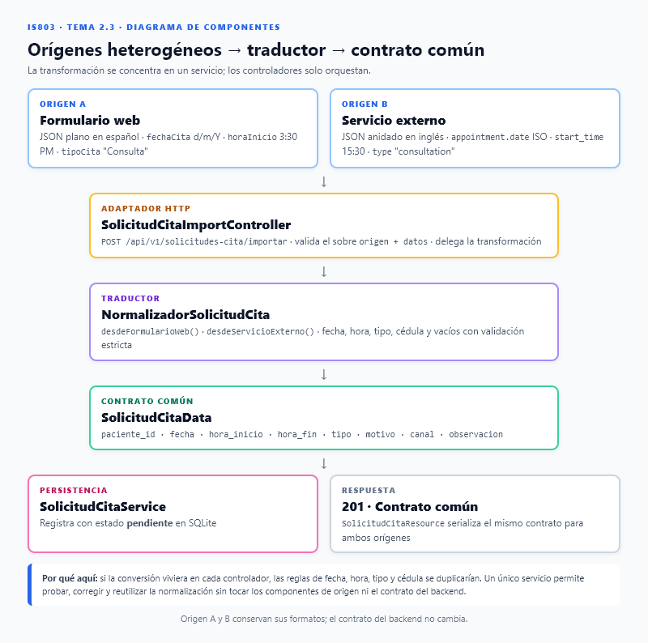

# IS803 · Tema 2.3 — Patrones de traducción y normalización

**Estudiante:** Luis Andrés Mendoza Zambrano

**Curso / paralelo:** 8.º nivel / A

**Fecha:** 17/11/2026

**Repositorio:** <https://github.com/Luis-M25/DTO-y-contratos-de-intercambio-JSON>

**Rama individual:** `practica-2.3-lmendoza`

## 1. Conflicto estructural identificado

En el proyecto de aula, una solicitud de cita puede llegar desde dos componentes que representan los mismos datos de forma distinta:

- **Origen A — formulario web:** JSON plano, nombres en español y formatos pensados para la pantalla.
- **Origen B — servicio externo simulado:** JSON anidado, nombres en inglés y valores nativos (ISO 8601, 24 horas).

### Entrada del origen A

```json
{
  "origen": "formulario_web",
  "datos": {
    "cedula": "0102030405",
    "fechaCita": "20/11/2026",
    "horaInicio": "3:30 PM",
    "horaFin": "4:00 PM",
    "tipoCita": "Consulta",
    "motivo": "Dolor dental",
    "observacion": ""
  }
}
```

### Entrada del origen B

```json
{
  "origen": "servicio_externo",
  "datos": {
    "patient": {
      "document_number": "010-203-0405"
    },
    "appointment": {
      "date": "2026-11-20",
      "start_time": "15:30",
      "end_time": "16:00",
      "type": "consultation"
    },
    "reason": "Dolor dental",
    "notes": null
  }
}
```

### Diferencias explicadas

1. **Nombres e idioma:** `fechaCita` frente a `appointment.date`; `motivo` frente a `reason`.
2. **Estructura:** el origen A es plano; el origen B agrupa los datos en `patient` y `appointment`.
3. **Formatos de fecha y hora:** A usa `DD/MM/AAAA` y 12 horas con AM/PM; B usa ISO 8601 y 24 horas.
4. **Tipos y valores de dominio:** A envía la cédula con diez dígitos y el tipo `"Consulta"`; B envía la cédula con guiones y el tipo `"consultation"`.
5. **Representación de vacíos:** A envía `""`; B envía `null`. Ambos deben terminar en `null`.

### Contrato común normalizado

```json
{
  "paciente_id": "11111111-1111-4111-8111-111111111111",
  "fecha": "2026-11-20",
  "hora_inicio": "15:30",
  "hora_fin": "16:00",
  "tipo": "consulta",
  "motivo": "Dolor dental",
  "canal": "web",
  "observacion": null
}
```

El contrato es el mismo de la práctica 2.2. No se agregaron campos ni se modificó el endpoint existente. El origen B usa `canal: "movil"` porque ese metadato identifica al adaptador que lo procesó; los campos clínicos son equivalentes.

## 2. Tabla de mapeo

| Origen A (formulario web) | Origen B (servicio externo) | Contrato común | Regla aplicada |
|---|---|---|---|
| `cedula: "0102030405"` | `patient.document_number: "010-203-0405"` | `paciente_id: UUID` | Quitar separadores, exigir 10 dígitos y buscar al paciente; si no existe, error 422 |
| `fechaCita: "20/11/2026"` | `appointment.date: "2026-11-20"` | `fecha: "2026-11-20"` | Parseo estricto `DD/MM/AAAA` o ISO; validar que la fecha exista en el calendario |
| `horaInicio: "3:30 PM"` | `appointment.start_time: "15:30"` | `hora_inicio: "15:30"` | Convertir 12 h a 24 h o validar 24 h |
| `horaFin: "4:00 PM"` | `appointment.end_time: "16:00"` | `hora_fin: "16:00"` | Convertir y exigir que sea posterior a `hora_inicio` |
| `tipoCita: "Consulta"` | `appointment.type: "consultation"` | `tipo: "consulta"` | Catálogo cerrado: consulta, tratamiento, control; valor desconocido = error |
| `motivo` | `reason` | `motivo` | Renombrar, recortar espacios, obligatorio y máximo 255 caracteres |
| `observacion: ""` | `notes: null` | `observacion: null` | Cadena vacía o solo espacios se convierte en `null`; máximo 500 caracteres |
| — | — | `canal: "web"` / `"movil"` | Lo asigna el adaptador según el origen; no lo envía el cliente |

## 3. Implementación del traductor

### Flujo

```text
Origen A ─┐
          ├→ SolicitudCitaImportController → NormalizadorSolicitudCita
Origen B ─┘                                      │
                                                 ├→ desdeFormularioWeb()
                                                 └→ desdeServicioExterno()
                                                          │
                                                          ▼
                                             SolicitudCitaData (contrato común)
                                                          │
                                                          ▼
                                             SolicitudCitaService → SQLite
                                                          │
                                                          ▼
                                             201 + SolicitudCitaResource
```

### Archivos

| Archivo | Responsabilidad |
|---|---|
| `app/Services/NormalizadorSolicitudCita.php` | Traduce cada origen y devuelve `SolicitudCitaData`. |
| `app/Exceptions/NormalizacionException.php` | Errores explícitos con `message`, `errors` y `origen`. |
| `app/Support/ReglasSolicitudCita.php` | Reglas y mensajes compartidos con el endpoint principal. |
| `app/Http/Requests/ImportSolicitudCitaRequest.php` | Valida el sobre `origen + datos`. |
| `app/Http/Controllers/Api/V1/SolicitudCitaImportController.php` | Orquesta la importación y delega en el servicio. |
| `routes/api.php` | Expone `POST /api/v1/solicitudes-cita/importar`. |
| `tests/Feature/NormalizacionSolicitudCitaTest.php` | Pruebas P1–P8 del normalizador. |

### Métodos principales

```php
public function normalizar(string $origen, array $datos): SolicitudCitaData
{
    return match ($origen) {
        self::ORIGEN_FORMULARIO_WEB => $this->desdeFormularioWeb($datos),
        self::ORIGEN_SERVICIO_EXTERNO => $this->desdeServicioExterno($datos),
        default => throw new NormalizacionException(...),
    };
}

public function desdeFormularioWeb(array $datos): SolicitudCitaData
public function desdeServicioExterno(array $datos): SolicitudCitaData
```

### Conversiones estrictas

```php
// Fecha del formulario: DD/MM/AAAA
if (! preg_match('/^(\d{2})\/(\d{2})\/(\d{4})$/', $valor, $partes)
    || ! checkdate((int) $partes[2], (int) $partes[1], (int) $partes[3])) {
    throw new NormalizacionException(
        'La fecha indicada no existe en el calendario.',
        ['fecha' => ['La fecha indicada no existe en el calendario.']],
        self::ORIGEN_FORMULARIO_WEB,
    );
}

// Hora del formulario: 12 h → 24 h
$hora = ((int) $partes[1]) % 12;
if ($partes[3] === 'PM') {
    $hora += 12;
}
return sprintf('%02d:%s', $hora, $partes[2]);
```

### Manejo de errores

- Si falta un campo obligatorio, se devuelve `422` con `errors.<campo>`.
- Si la fecha no existe (`31/02/2026`), no se convierte silenciosamente: se rechaza.
- Si el tipo no pertenece al catálogo, se rechaza con el valor esperado.
- Si la cédula no corresponde a un paciente, no se crea un paciente nuevo: se devuelve `422`.
- Si la validación final falla, se reutilizan las reglas del contrato común y se devuelven los mismos mensajes que el endpoint principal.

## 4. Verificación de interoperabilidad

P1 y P2 envían los mismos datos con estructuras distintas. Ambos terminan en el mismo contrato: mismo `paciente_id`, `fecha`, `hora_inicio`, `hora_fin`, `tipo` y `estado`. La única diferencia es `canal`, que identifica el origen (`web` o `movil`) y no forma parte del significado clínico de la cita.

La transformación vive en `NormalizadorSolicitudCita` y no en los controladores porque:

- evita duplicar reglas de fecha, hora, tipo y cédula;
- permite probar la traducción de forma aislada;
- mantiene los componentes de origen sin cambios;
- permite agregar un tercer origen implementando un nuevo método, sin tocar el contrato del backend.

### Pruebas automatizadas

```text
Tests: 13 passed (79 assertions)
```

| Caso | Entrada o condición | Resultado esperado | Resultado obtenido |
|---|---|---|---|
| P1 | Formulario web válido | 201 y contrato común; registro en SQLite | 201, contrato correcto y cita registrada |
| P2 | Servicio externo equivalente | Mismo contrato que P1 | 201, campos clínicos idénticos; `canal: movil` |
| P3 | Formulario sin `motivo` | 422 con `errors.motivo`; sin registro | 422 y base sin cambios |
| P4 | Fecha `31/02/2026` | 422 con error de calendario | 422, error explícito en `fecha` |
| P5 | Hora de fin anterior | 422 con `errors.hora_fin` | 422, error explícito en `hora_fin` |
| P6 | Tipo `"Consulta general"` | 422; no se convierte silenciosamente | 422, error en `tipo` |
| P7 | Cédula inexistente en origen B | 422 con `errors.paciente_id` | 422, no se crea paciente |
| P8 | `observacion: "   "` | `null` en el contrato | `null` persistido |

### Postman / Newman

```text
requests: 6
assertions: 13
failed: 0
```

La colección `postman/IS803-T2.3-Normalizacion.postman_collection.json` incluye P1–P6 y compara automáticamente P1 con P2.

## 5. Evidencias

### P1 — Formulario web válido



### P2 — Servicio externo equivalente



### P3 — Error de validación explícito



### Pruebas automatizadas



### Diagrama de componentes



## 6. Reflexión individual

### ¿Qué problema de integración resolviste?

Resolví el problema de que un formulario web y un servicio externo representaran la misma solicitud de cita con nombres, formatos y estructuras diferentes. Sin un traductor, el backend tendría que aceptar dos contratos o cada controlador tendría que repetir las conversiones de fecha, hora, tipo y cédula. Con `NormalizadorSolicitudCita`, ambos orígenes producen el mismo `SolicitudCitaData` y el endpoint principal conserva su contrato.

### ¿Qué decisión técnica tomaste y por qué?

Separé la transformación en un servicio con un método por origen y reutilicé las reglas del contrato común mediante `ReglasSolicitudCita`. Elegí conversiones estrictas: una fecha inválida, una hora fuera de formato, un tipo desconocido o una cédula inexistente generan un `422` explícito; no se corrigen valores en silencio. También mantuve el paciente identificado por `paciente_id` (UUID) y resolví la cédula dentro del adaptador, para que los clientes no necesiten conocer el UUID. El canal se asigna según el origen y no se acepta como dato libre.

### ¿Cómo verificaste que la solución funciona en tu proyecto?

Con 13 pruebas automatizadas (79 aserciones) que cubren P1–P8 y conservan las 5 pruebas de la práctica 2.2. P1 y P2 comprueban que dos entradas heterogéneas producen los mismos campos clínicos; P3–P7 comprueban errores explícitos sin persistencia; P8 comprueba la normalización de vacíos. Además ejecuté la colección Postman con Newman: 6 solicitudes, 13 aserciones y 0 fallos. Las capturas de P1, P2 y P3 muestran la entrada, la salida y el error real del servidor local.

## 7. Cómo reproducir

```powershell
git clone https://github.com/Luis-M25/DTO-y-contratos-de-intercambio-JSON.git
cd DTO-y-contratos-de-intercambio-JSON
git switch practica-2.3-lmendoza
php artisan migrate:fresh --seed
php artisan test
php -S 127.0.0.1:8000 -t public public/index.php
```

En otra terminal:

```powershell
npx newman run postman/IS803-T2.3-Normalizacion.postman_collection.json `
  -e postman/IS803-T2.3-Normalizacion.postman_environment.json
```

> Las capturas usan datos ficticios. No se incluyen tokens, contraseñas ni archivos `.env`.
